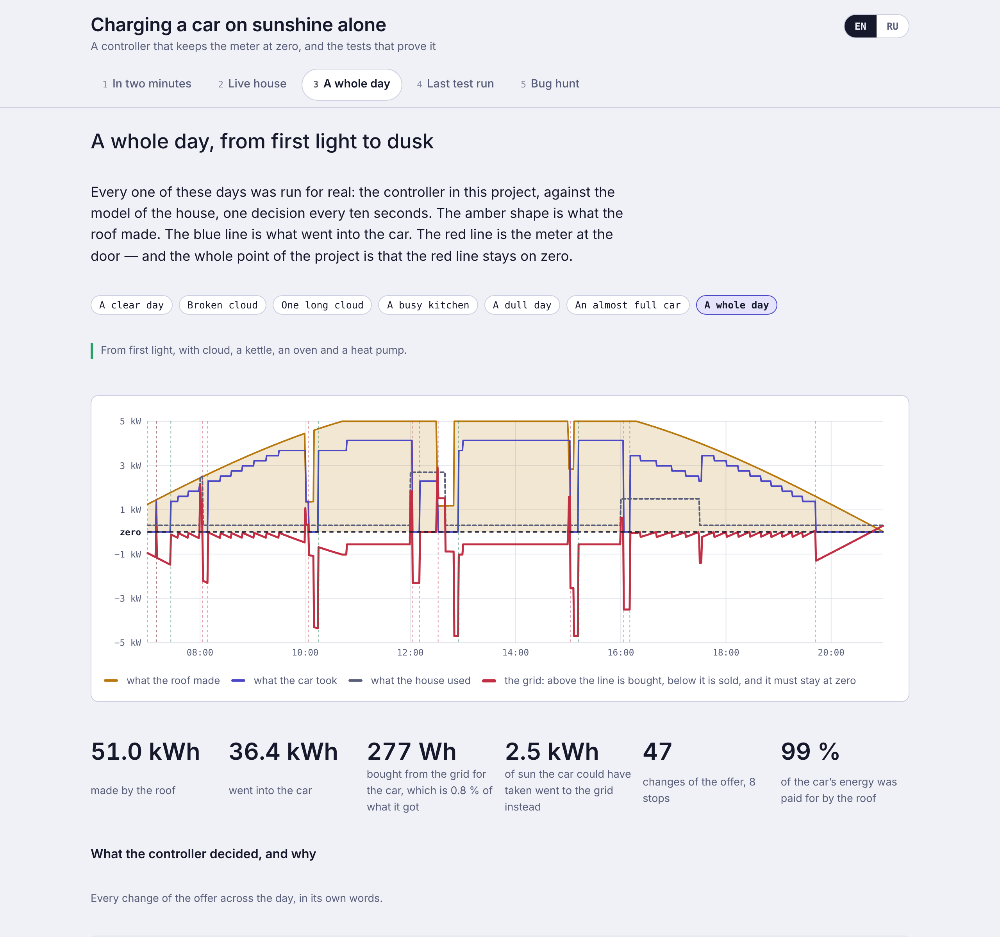
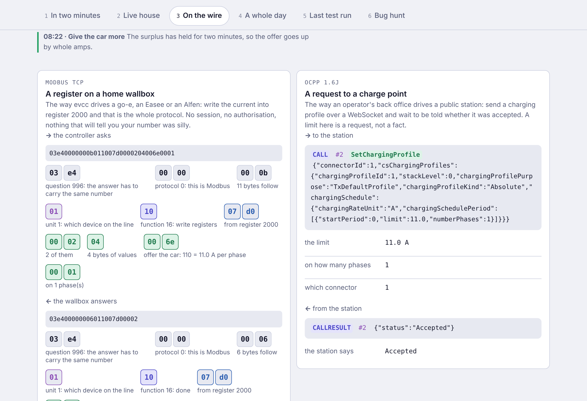

# solar-surplus-charging

[](https://github.com/NailKarimov/solar-surplus-charging/actions/workflows/tests.yml)
[](https://nailkarimov.github.io/solar-surplus-charging/index.html)
[](https://github.com/NailKarimov/solar-surplus-charging/releases)
[](https://codespaces.new/NailKarimov/solar-surplus-charging?quickstart=1)

### ▶ Open online

| Page                                                                                                                  | What it is                                                              |
| ----------------------------------------------------------------------------------------------------------------------- | --------------------------------------------------------------------------- |
| **[What this is, in two minutes](https://nailkarimov.github.io/solar-surplus-charging/surplus-charging.html#tour)**   | one day stopped at the seven moments where something happens, each with a caption |
| **[The live house](https://nailkarimov.github.io/solar-surplus-charging/surplus-charging.html#live)**                 | send a cloud over, put the kettle on, cut the meter, plant a bug        |
| **[On the wire](https://nailkarimov.github.io/solar-surplus-charging/surplus-charging.html#wire)**                    | the same decision as a Modbus register and as an OCPP profile, byte by byte |
| **[A whole day](https://nailkarimov.github.io/solar-surplus-charging/surplus-charging.html#day)**                     | the chart that is the point of the project: the grid line sits on zero  |
| [Last test run, replayed](https://nailkarimov.github.io/solar-surplus-charging/surplus-charging.html#replay)          | every check as one sentence, with the kilowatt-hours it measured        |
| [Bug hunt](https://nailkarimov.github.io/solar-surplus-charging/surplus-charging.html#bugs)                           | 38 planted bugs and the checks that caught each                         |
| [Allure test report](https://nailkarimov.github.io/solar-surplus-charging/index.html)                                 | latest CI run, three passes of the suite                                |

Click these links: opening an `.html` file in the file list shows its source code, GitHub does not run it.

[](https://nailkarimov.github.io/solar-surplus-charging/surplus-charging.html#day)

Solar panels make electricity while the sun is out. The house takes what it needs and the rest is sold to the grid
for very little. An electric car in the drive could take that surplus instead — but only if something watches the
meter every few seconds and tells the car exactly how much it may have, right now.

This project is that something, and the **Python + pytest** suite that proves it keeps three promises:

1. **Buy nothing.** On an ordinary day, 277 Wh of the 36.4 kWh that reached the car came off the grid: 0.8 %.
2. **Sell nothing the car could take.** 4.9 % of what the roof made went to the grid while the car had room for it.
3. **Leave the car alone.** 47 changes to the offer in thirteen hours, and the session was stopped 8 times.

Those three pull against each other, and that tension is the whole engineering problem. The same controller is
driven three ways — straight into the model, over **Modbus TCP** the way a home wallbox is driven, and over
**OCPP 1.6J** the way a public charge point is — and a test replays a whole day through all three and compares
them decision by decision.

The project is built to be shown to people who do not read code. Every test is one plain sentence, and one page
turns the run into pictures: [open it](https://nailkarimov.github.io/solar-surplus-charging/surplus-charging.html).

## At a glance

| Row                | Content                                                                                                                                                                            |
| -------------------- | -------------------------------------------------------------------------------------------------------------------------------------------------------------------------------------- |
| System under test  | A surplus-charging controller (`src/surplus_lab/control.py`) and the house it runs in: sun and cloud, household loads, a car that ramps and tapers, a grid meter that can go quiet |
| Language and tools | Python 3.12; pytest, Hypothesis, websockets, Allure, ruff, mypy; Playwright and Node.js for the visual page                                                                        |
| Types of testing   | Functional behaviour over whole days, boundary (the 6 A floor, the three-phase floor), state transitions, negative, fail-safe, property-based fuzzing, protocol conformance, cross-implementation |
| Tests              | 101 across three kinds of wallbox (91 of them behaviour, run once against the model) + 34 browser tests of the visual page                                                         |
| Test quality       | 38/38 planted bugs caught (`scripts/mutants.py`); the JavaScript twin makes 88 560 identical decisions across 20 days, 8 of them generated at random, and rebuilds the drivers' own frames byte for byte                               |
| Reports            | [Allure](https://nailkarimov.github.io/solar-surplus-charging/index.html) · [visual page](https://nailkarimov.github.io/solar-surplus-charging/surplus-charging.html) · [mutation table](https://nailkarimov.github.io/solar-surplus-charging/mutants/result.md) |

## What is tested

| Suite                   | What it proves                                                                                                        |
| ------------------------- | ----------------------------------------------------------------------------------------------------------------------- |
| `test_promises`         | Over seven whole days: what the car cost in bought electricity, what was given away, how often the car was disturbed  |
| `test_arithmetic`       | The one line the controller rests on, and why watts become whole amps rounded **down**                                |
| `test_clouds`           | A short shadow is ridden out, a long one is not, and the ride-out ends on the money it has spent                      |
| `test_household`        | A kettle is a cloud as far as the meter is concerned; the house comes first and the car gets what is left             |
| `test_floor`            | The offer is never between nothing and 6 A, and the floor is not a cliff to fall off every few minutes                |
| `test_phases`           | Three phases are not asked for where three phases cannot charge; a switch is not undone a minute later                |
| `test_failsafe`         | A meter that has gone quiet stops the charging; an unplugged car is offered nothing; the night is not spent buying     |
| `test_drivers`          | The Modbus register map and the OCPP exchange, and a whole day replayed through all three wallboxes, decision by decision |
| `test_robustness`       | Hypothesis: whatever the meter says, the offer is zero or a legal whole number of amps                                |
| `test_pages`, `twin.test.mjs` | The visual page works in a browser, its JavaScript twin decides exactly like the Python controller, and the frames it draws are the ones the drivers really sent |

## The seven days

Measured, not asserted. This table is produced by running the real controller against the model.

| Day                | The roof made | Into the car | Bought for the car |     | Given away it could have had |     | Changes | Stops |
| -------------------- | --------------: | -------------: | -------------------: | ----: | -----------------------------: | ----: | --------: | ------: |
| A clear day        |     51.1 kWh |    39.4 kWh |               6 Wh | 0.0 % |                      0.9 kWh | 1.8 % |      21 |     2 |
| Broken cloud       |     47.5 kWh |    34.1 kWh |             400 Wh | 1.2 % |                      5.1 kWh | 10.8 % |     75 |    12 |
| One long cloud     |     47.4 kWh |    37.4 kWh |              75 Wh | 0.2 % |                      1.3 kWh | 2.7 % |      26 |     4 |
| A busy kitchen     |     51.1 kWh |    36.8 kWh |             205 Wh | 0.6 % |                      2.8 kWh | 5.5 % |      33 |     5 |
| A dull day         |     12.1 kWh |       4 Wh |               3 Wh |     — |                            0 |     — |       2 |     1 |
| An almost full car |     51.1 kWh |     6.0 kWh |               0 Wh | 0.0 % |                      0.4 kWh | 0.7 % |      21 |     2 |
| A whole day        |     51.0 kWh |    36.4 kWh |             277 Wh | 0.8 % |                      2.5 kWh | 4.9 % |      47 |     8 |

Broken cloud is the hard one, and it is where the trade-off is visible: holding on through shadows costs a little
bought electricity, and letting go costs spilled sun. The suite asserts that both stay inside a budget.

[](https://nailkarimov.github.io/solar-surplus-charging/surplus-charging.html#wire)

## Findings

No defects are open: the system under test is this project's own controller, and it is corrected when a test finds
a fault. Six findings made on the way — one the mutation check turned up that was a problem with the *design*
rather than the tests, and one that no test could have found because both ends of a protocol shared the same
misunderstanding until the page printed the message out — are in
[`docs/test-report.md`](docs/test-report.md), section 3. Bug reports for
third-party systems of the portfolio are on the [QA defects board](https://github.com/users/NailKarimov/projects/2).

## Running it

No local setup: the **Open in GitHub Codespaces** badge starts a browser VS Code with Python, Node and Chromium
installed; then `pytest` works in the terminal.

Locally:

```bash
pip install -e ".[dev,pages]"
pytest                               # the control law, against the model
DRIVER=modbus pytest                 # the driver checks, over a real Modbus TCP socket
DRIVER=ocpp pytest                   # the driver checks, over a real OCPP WebSocket
python scripts/mutants.py            # plant 38 bugs, one at a time, and count the catches
python scripts/build_pages.py        # rebuild docs/surplus-charging.html from the last run
node site/test/twin.test.mjs         # the twin and the frame encoders against the Python originals
```

## Project structure

```text
src/surplus_lab/house.py      the sun, the clouds, the household, the car, the meter at the door
src/surplus_lab/control.py    the controller under test: one lever, one instrument, three promises
src/surplus_lab/day.py        the named days, and the four-line loop that runs one
src/surplus_lab/drivers/      straight into the model, a Modbus TCP wallbox, an OCPP 1.6 charge point
tests/                        one file per subject; conftest.py picks the driver and records the run
tests/support/                the rig that wires a house to a controller, and the evidence recorder
scripts/                      mutants.py (mutation check), build_pages.py (visual page, twin vectors), wire.py (real frames, labelled byte by byte)
site/                         source of the visual page: six views, the chart, the JavaScript twin and the two frame encoders
docs/                         the built page, test plan, test report, guide, screenshots
evidence/                     mutants.json; run-<driver>.json is written by every test run
```

## Design decisions

- **The controller never sees the sun.** It sees the meter at the house connection point and what the car is
  drawing, and nothing else. That is how every real installation works, and it is why the tests can be honest:
  there is no privileged information to lean on.
- **Measured in watt-hours, not in assertions about state.** "Bought for the car" is the part of the import the
  car caused; "given away" is export the car could actually have taken, at least one whole amp of it. Both are
  defined in `house.py` and both are deliberately generous to the controller, so a pass means something.
- **Asymmetric in time.** The offer comes down on the next reading and goes up only after the surplus has held.
  Mistakes belong on the cheap side: spilled sun is worth about a quarter of bought electricity.
- **One timer, one reset.** Every rule about how fast the offer may move is one subtraction against a single
  clock. That was not the first design; see finding SS-4.
- **Time moves only on command.** There is no real clock in the tests. A whole day runs in milliseconds and every
  run sees the same day.
- **Every test is a sentence.** A test without a one-sentence docstring fails collection. The sentence is the
  title in Allure and on the visual page, in English and in Russian.
- **The page shows the real run.** The days on the chart are produced by running the controller; the live house
  is a JavaScript twin checked decision by decision against the Python one.

## CI

`.github/workflows/tests.yml` runs on push, pull request, nightly and on demand: lint and type check, the suite
through all three wallboxes, the build of the visual page from that run, the twin check, the browser tests. The
Allure report with history, the visual page and the mutation table go to GitHub Pages. The mutation job runs on
demand (a checkbox in "Run workflow").

Releases: committing `.github/releases/<tag>.md` runs the Release workflow, which creates the tag and the GitHub
release with that file as its notes.

## Documentation

| Document                                                 | What it is                                                                 |
| ---------------------------------------------------------- | ---------------------------------------------------------------------------- |
| [`docs/test-plan.md`](docs/test-plan.md)                 | test plan (ISO/IEC/IEEE 29119-3)                                           |
| [`docs/test-report.md`](docs/test-report.md)             | test summary report: latest results, findings, deviations                  |
| [`docs/surplus-charging.md`](docs/surplus-charging.md)   | guide: the problem, the control law, the two drivers, the page             |
| [`docs/surplus-charging.html`](https://nailkarimov.github.io/solar-surplus-charging/surplus-charging.html) | the same as an interactive page with six views (EN/RU) |
| [`mutants-result.md`](mutants-result.md)                 | the mutation table of the latest full run                                  |

## Part of a portfolio

One of the test automation projects by [Nail Karimov](https://github.com/NailKarimov):
[all projects](https://github.com/NailKarimov) ·
[testing map](https://nailkarimov.github.io/api-test-automation/testing-map.html) ·
[toolbox](https://nailkarimov.github.io/api-test-automation/toolbox.html).

It is the third of the energy-protocol projects, and the one that joins the other two: the inverter in
[solar-inverter-testing](https://github.com/NailKarimov/solar-inverter-testing) is where the surplus comes from,
and the charge point in [ev-charging-testing](https://github.com/NailKarimov/ev-charging-testing) is what the
surplus is sent to.
