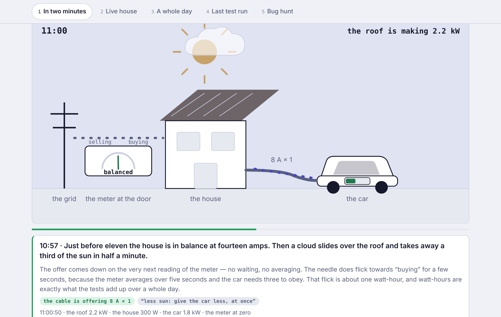
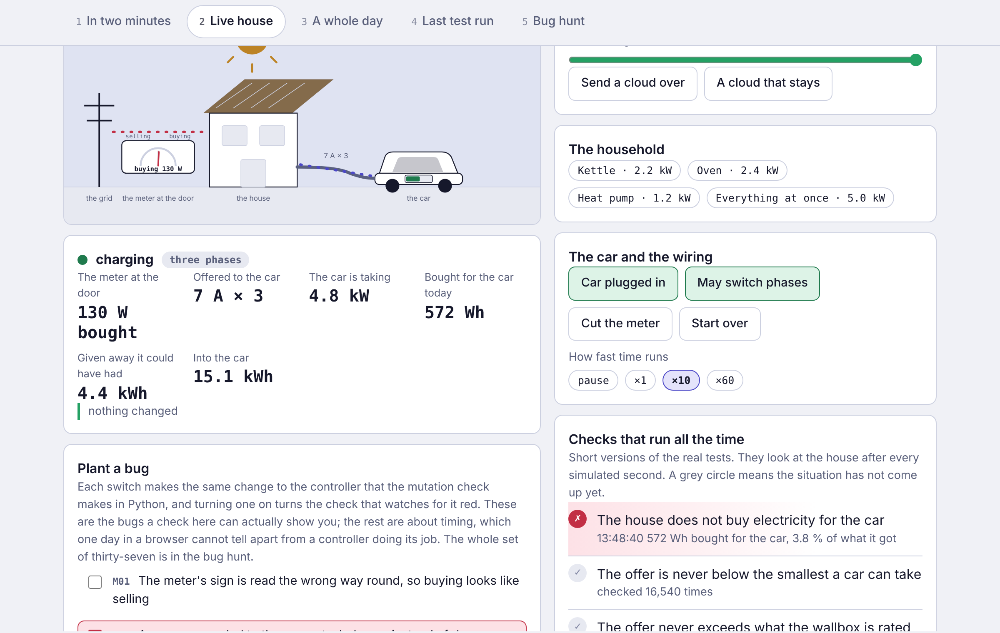
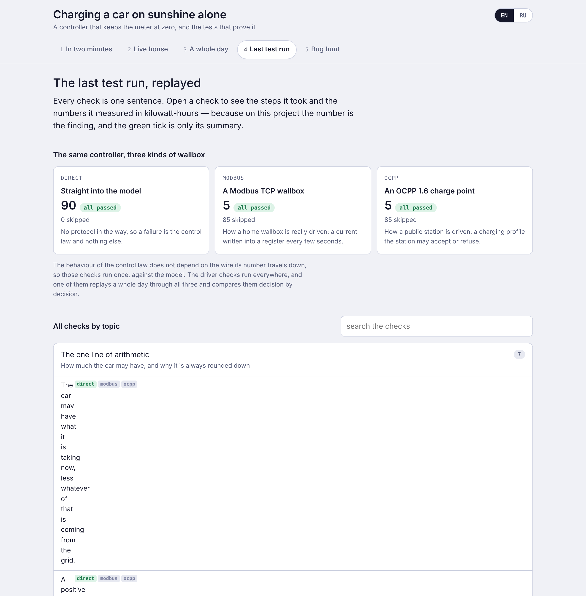
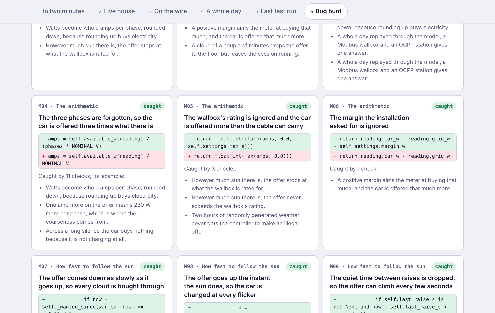

# A guide to this project

What the problem actually is, how the controller solves it, why three reasonable goals cannot all be met at
once, and what the five views of the visual page show. Written for a reader who has never thought about
electricity meters.

The same material, with pictures and a house you can operate yourself, is at
[surplus-charging.html](https://nailkarimov.github.io/solar-surplus-charging/surplus-charging.html).

## 1. The problem, in one picture

A house with solar panels is three things on one wire: the panels making power, the household using it, and the
meter at the front door counting the difference.

```text
    grid  =  household  +  car  −  roof
```

Positive means the house is **buying** from the grid. Negative means it is **selling** — and in most of Europe it
is sold for a quarter of what it costs to buy back, or less. So a house with panels has an unglamorous but real
goal: use your own electricity rather than selling it cheaply and buying it back dearly.

An electric car is by far the biggest thing in the house that can absorb a surplus. It is also the most awkward,
because its appetite cannot be set to just anything.

## 2. Why the car cannot simply be told "take the surplus"

**The pilot wire has a floor.** IEC 61851-1 gives the station one way to tell the car how much it may take: the
duty cycle of a 1 kHz square wave, where duty × 0.6 is the current in amps. Below **6 A** the signal means
something else entirely, so there is no such thing as charging a car at two amps. Either the car takes at least
1.4 kW on one phase — or 4.1 kW on three — or it takes nothing at all.

**Amps are whole numbers, and on three phases they are large.** One amp more on one phase is 230 W. One amp more
on three phases is 690 W. A controller on three phases is steering a 4 kW car with a lever that moves in
690 W steps.

**One phase and three phases do not overlap neatly.** One phase carries at most 16 A, which is 3680 W. Three
phases cannot carry less than 4140 W. Between those numbers, one phase is the only thing that works. Switching
between them means stopping the session and starting it again.

**The car is not a resistor.** It ramps towards the offer rather than jumping to it, it never takes more than it
was offered, and once it is nearly full it tapers and quietly takes less than it is allowed. A controller that
assumes the car took exactly what it was offered will buy electricity and never know why.

**And the meter is the only instrument there is.** It reports an average over its sampling period, not the
instant truth, and it can stop reporting altogether.

## 3. The one line of arithmetic

Everything the controller computes is this:

```text
    the car may have  =  what the car takes now  −  what the meter reads  +  the margin we allow
```

If the meter reads +200 W while the car pulls 3000 W, then 2800 W of what the car is taking comes from the roof
and 200 W from the grid: the car may have 2800 W. If the meter reads −1500 W, the house is spilling 1500 W and
the car may have 4500 W.

Turn that into amps per phase and **round down**. Rounding up buys electricity, every time, for ever.

That is the whole of the arithmetic. Everything else in `control.py` is about *time*.

## 4. Three promises that pull against each other

1. **Buy nothing.** When a cloud crosses the roof or a kettle goes on, the surplus vanishes in one second. The
   offer has to come down at once, or the house starts buying.
2. **Sell nothing the car could take.** When the sun comes back, the offer has to go up, or the house gives the
   surplus away for a quarter of its worth.
3. **Leave the car alone.** A car is not a dimmer. Every change is a message, every pause is a contactor, and a
   car that is stopped and started every ninety seconds will eventually sulk and refuse to wake up.

Promise 1 wants an instant reaction. Promise 3 wants none. Promise 2 wants an instant reaction in the other
direction. They cannot all be satisfied, and the design is where they meet.

The resolution is to be **asymmetric in time**: come down on the very next reading, and go up only after the
larger surplus has held for a couple of minutes. Broken cloud therefore costs a little spilled sun — the cheap
mistake — rather than bought electricity or a pestered car, which are the expensive ones.

## 5. The floor, and the budget for waiting

A shadow that takes the surplus below 6 A leaves three choices: stop the session, hold the floor and buy the
difference, or pretend. The third is not a choice.

Stopping costs a restart: the controller waits five minutes before trusting the sun again, and five minutes of
a four-kilowatt surplus is about 330 Wh given to the grid. Holding on costs whatever the shadow lasts: 1.4 kW on
one phase, 4.1 kW on three.

So the wait is bounded **by money, not only by the clock**. The controller counts what the meter says it is
buying while it holds on, and lets go when that reaches about 60 Wh — roughly what a restart is worth once
spilled sun is converted at the usual ratio of import to export prices. On three phases the same six amps costs
three times as much, so the budget runs out three times sooner, which is exactly right.

Getting this wrong was the project's first real finding: a fixed three-minute wait bought 1.5 kWh on a day of
broken cloud, 4.4 % of everything that reached the car. See [`test-report.md`](test-report.md), SS-1.

## 6. One phase or three

The obvious rule — "switch to three phases when one phase is full" — is wrong, and wrong in a way that looks
right. One phase is full at 3680 W; three phases cannot charge at all below 4140 W. A controller that switches up
at 3680 W moves the car onto wiring that cannot carry the surplus, and immediately finds itself below the floor.

The threshold belongs at the three-phase floor, with a margin above it so the up-threshold and the down-threshold
do not sit on top of each other and flap. Switching also costs a stop and a start, so it waits ten minutes before
acting on a wish and will not switch again for half an hour.

The price of three phases is coarseness: one amp is 690 W there and 230 W on one phase, so three-phase charging
always leaves a little more sun on the table.

## 7. When the controller cannot see

The meter is the only instrument. A controller that keeps charging on a reading that stopped changing half an
hour ago is not keeping a promise about the grid; it is hoping. So a reading older than the configured age is not
a reading, and the session stops — stopping cannot buy electricity. The same goes for a car that has been
unplugged, and for the night.

## 8. The same law, three different wallboxes

The controller knows two verbs: *tell me what the car is doing*, and *offer the car this many amps on this many
phases*. Everything protocol-shaped lives behind that seam, and three things sit behind it:

| Driver     | What it is                                | What it is like                                                                 |
| ------------ | ------------------------------------------- | --------------------------------------------------------------------------------- |
| `direct`   | straight into the model                   | the reference: no protocol in the way, so a failure is the control law            |
| `modbus`   | a Modbus TCP wallbox, as evcc drives one  | a register. Write 120 into register 2000 and the car is offered 12.0 A            |
| `ocpp`     | an OCPP 1.6J charge point                 | a counterparty. Send `SetChargingProfile` and the station may answer `Rejected`   |

The Modbus register map is in tenths of an amp — exactly the kind of unit that gets forgotten once and then shows
up as a car charging at 1.6 A (planted bug M31). The OCPP station reports what the car is doing in its own
`MeterValues` messages, and the grid meter is not part of OCPP at all: it is a different device on a different
wire, which is how a real installation is built.

A test replays a whole day through all three and compares them decision by decision, and then compares the energy
that ended up in the car. A control law that behaves differently depending on which cable it is shouting down is
not a control law; it is a coincidence.

## 9. How the promises are measured

A pass has to mean something, so both numbers are defined to be generous to the controller.

- **Bought for the car** is the part of the import the *car* caused: at every second, the smaller of what the
  house was buying and what the car was taking. If the household uses more than the roof is making, the house
  buys electricity and no controller can stop it; that is not a broken promise.
- **Given away it could have had** is export the car could *actually* have absorbed: the car has to be plugged
  in and not full, the surplus has to be at least the smallest charge the pilot can ask for, and it has to be at
  least one whole amp's worth — because a pilot speaks in whole amps, and less than one amp of sun going out
  could not have been offered to the car without buying the difference.

Both are computed in `house.py` from the energy that actually moved, second by second.

## 10. How good are the tests?

A green suite says nothing about whether the tests would notice a real defect. `scripts/mutants.py` answers that
directly: it plants **37 bugs**, one at a time, in the source, runs the suite, and records which tests went red.

The bugs are the ones a person would actually write: the meter's sign the wrong way round, amps rounded to the
nearest instead of down, the three phases forgotten in a division, the offer coming down as slowly as it goes up,
a register read as amps when it holds tenths of an amp. The current result is **37 of 37 caught**, with a control
run that plants nothing and passes.

Two of those bugs did not start out caught, and neither was a missing test: one of them could not be caught at
all, because two pieces of the code were resetting the same clock and each hid the other's absence. That is
finding SS-4, and it is the best argument for mutation testing there is.

## 11. The visual page

`docs/surplus-charging.html` is one self-contained file with five views, in English and Russian.

| View | What you can do |
| --- | --- |
| **What this is, in two minutes** | one day stopped at seven moments — first light, the sun arriving, a cloud, the two-minute wait after it, the oven, a shadow deep enough to stop for, and the evening — each played slowly enough to follow, each with a caption saying what the house did and what the controller did about it |
| **The live house** | move the sun, send a cloud, put the kettle on, unplug the car, cut the meter, and **plant a bug** |
| **A whole day** | the chart: what the roof made, what the car took, and the grid line on zero, for seven different days |
| **Last test run** | every check as one sentence; open one and see its steps and the watt-hours it measured |
| **Bug hunt** | all 37 planted bugs, the line each one changed, and the tests that caught it |

The tour does not race. An earlier version played a whole day in a few seconds, and everything on the screen
merely twitched: the point of a controller is *when* it acts, and at seven thousand times real time there is no
when. It now stops at the seven moments where a decision is actually made, runs the slow ones at about thirty
times real time, and prints the controller's own reason for what it just did. The captions were written against
measured runs, not from memory, and three of the browser tests play those moments through and check that the
offer really falls under the cloud and that the deep shadow really spends the ride-out budget and lets go.

Two things keep the page honest. The days on the chart are produced by running the real controller against the
real model — the page cannot show a day that did not happen. And the live house is a **JavaScript twin** of the
Python controller: `site/test/twin.test.mjs` replays twenty days through both, eight of them generated at random,
and compares every single decision. Currently 88 560 of them, all identical. If the twin drifted, the page would
be a cartoon rather than a model, and CI fails before it ships.

## 12. Where to look in the code

```text
src/surplus_lab/house.py           the sun, the clouds, the household, the car, the meter, and the two measurements
src/surplus_lab/control.py         the controller: the arithmetic, the timing, the floor, the phases, the fail-safe
src/surplus_lab/day.py             the seven named days and the four-line loop that runs one
src/surplus_lab/drivers/direct.py  no protocol: the reference
src/surplus_lab/drivers/modbus.py  the register map, the MBAP framing and the exceptions
src/surplus_lab/drivers/ocpp.py    the OCPP-J exchange, and why the grid meter is not part of it
```

---

[](https://nailkarimov.github.io/solar-surplus-charging/surplus-charging.html#tour)

[](https://nailkarimov.github.io/solar-surplus-charging/surplus-charging.html#live)

[](https://nailkarimov.github.io/solar-surplus-charging/surplus-charging.html#replay)

[](https://nailkarimov.github.io/solar-surplus-charging/surplus-charging.html#bugs)
